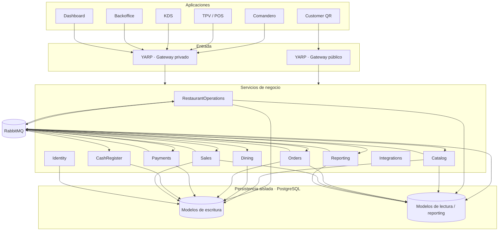
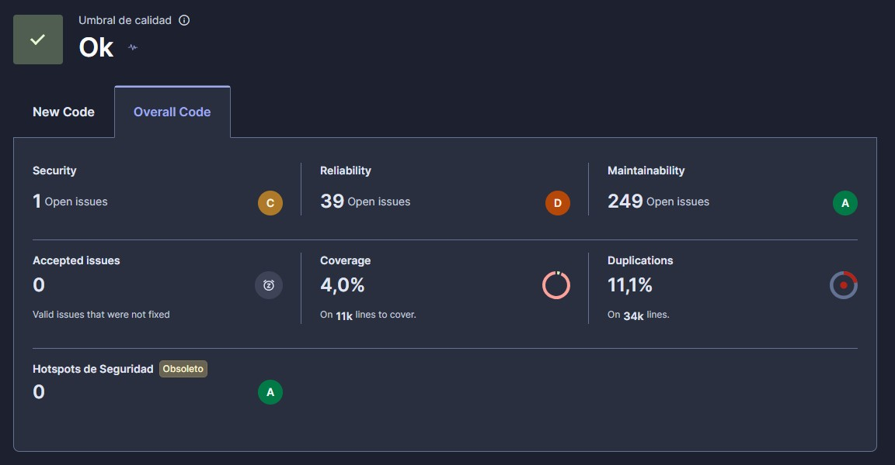

# 🍽️ Restaurantes

[](https://dotnet.microsoft.com/)
[](https://dotnet.microsoft.com/apps/aspnet/web-apps/blazor)
[](https://learn.microsoft.com/ef/core/)
[](https://microsoft.github.io/reverse-proxy/)

[](https://www.postgresql.org/)
[](https://www.rabbitmq.com/)
[](https://developer.hashicorp.com/vault)
[](https://docs.docker.com/compose/)

[](https://opentelemetry.io/)
[](https://opentelemetry.io/docs/collector/)
[](https://prometheus.io/)
[](https://grafana.com/)

**Restaurantes** es una plataforma distribuida para la operación y gestión de restaurantes, construida sobre **.NET 10**. Reúne servicios para catálogo, sala, pedidos, cocina, pagos, caja, ventas, identidad y reporting, con aplicaciones para clientes, personal y administración.

El repositorio presenta la arquitectura, sus objetivos y las áreas funcionales. Los detalles de cada servicio, flujo e infraestructura se encuentran en los [documentos de `docs`](docs/).

> [!IMPORTANT]
> Proyecto educativo en **desarrollo activo**; no es un producto comercial terminado.

## Arquitectura general



Los dominios **RestaurantOperations, Catalog, Orders y Sales** separan lectura y escritura; RabbitMQ actualiza sus proyecciones. Los demás servicios mantienen persistencia operacional.

Las aplicaciones entran por los gateways **YARP**. HTTP atiende operaciones síncronas, RabbitMQ distribuye eventos y SignalR notifica cambios en tiempo real. Rutas y observabilidad: [Gateways](docs/Gateways.README.md); flujos de negocio: documentos de cada servicio.

La autenticación usa **ASP.NET Core Identity y JWT**; la configuración y las reglas de acceso se describen en [Identity](docs/Identity.README.md).

## Servicios

| Servicio | Responsabilidad | Persistencia |
| --- | --- | --- |
| **[RestaurantOperations](docs/RestaurantOperations.README.md)** | Gestión e información base de restaurantes. | Write + Read |
| **[Catalog](docs/Catalog.README.md)** | Categorías, productos, precios, disponibilidad y configuración de estaciones por restaurante. | Write + Read |
| **[Orders](docs/Orders.README.md)** | Pedidos, líneas, estados de preparación y coordinación del flujo de cocina/KDS. | Write + Read |
| **[Dining](docs/Dining.README.md)** | Zonas, mesas, sesiones, QR, comensales y cuenta de mesa. | Write |
| **[Payments](docs/Payments.README.md)** | Capturas, devoluciones y estado de cobro. | Write |
| **[Sales](docs/Sales.README.md)** | Consolidación de ventas originadas en la operación. | Write + Read |
| **[CashRegister](docs/CashRegister.README.md)** | Apertura/cierre de caja, jornada operativa y conciliación de efectivo. | Write |
| **[Identity](docs/Identity.README.md)** | Usuarios, roles, autenticación y acceso por restaurante. | Write |
| **[Reporting](docs/Reporting.README.md)** | Proyecciones agregadas para actividad y ventas. | Read |
| **[Integrations](docs/Integrations.README.md)** | Punto de extensión para proveedores y sistemas externos. | — |

Cada servicio es propietario de sus datos; colaboran mediante contratos HTTP o eventos.

## Aplicaciones

| Perfil | Aplicación | Propósito | Tecnología |
| --- | --- | --- | --- |
| Cliente | **Customer QR** | Pago online obligatorio antes de enviar el pedido a cocina y seguimiento desde el QR asociado a una mesa/sesión. | Blazor WebAssembly PWA |
| Camarero | **Comandero** | Pedidos de mesa, cobro con tarjeta y liberación de mesa. | Blazor WebAssembly PWA |
| Caja | **TPV / POS** | Pedidos de sala y barra, canal Takeaway, cuentas y caja. | Blazor WebAssembly PWA |
| Cocina | **KDS** | Preparación y despacho por estación. | ASP.NET Core Web |
| Administración | **Backoffice** | Restaurantes, catálogo, sala y usuarios. | Blazor WebAssembly PWA |
| Oficina | **Dashboard** | Ventas, actividad operativa y salud de endpoints. | ASP.NET Core Web |

Los flujos de pedidos, pagos y cocina se detallan en [Orders](docs/Orders.README.md), [Dining](docs/Dining.README.md) y [Payments](docs/Payments.README.md).

## Estructura del repositorio

El código se organiza en `src` (servicios, clientes, gateways y componentes compartidos), `tests`, `docs` y `tools`. La solución y los perfiles de ejecución están en la raíz.

## Entorno local

### Requisitos

- .NET 10 SDK
- Docker / Docker Compose
- Visual Studio 2026 o un entorno compatible con .NET 10

### Infraestructura

Compose levanta la infraestructura local; SonarQube Community Build está en el perfil opcional `quality`.

Configura `tools/vault/.env` desde `.env.example` con valores locales; el archivo está excluido de Git.

```bash
docker compose --env-file tools/vault/.env up -d
```

### Observabilidad

La pila local usa OpenTelemetry, Prometheus y Grafana. Detalles en [Gateways](docs/Gateways.README.md#observabilidad-de-gateways-y-apis).


### Calidad y seguridad local

SonarQube Community Build se inicia bajo el perfil opcional `quality`:

```powershell
docker compose --env-file tools/vault/.env --profile quality up -d sonarqube
```

Proporciona el token de análisis solo en la sesión actual de PowerShell:

```powershell
$env:SONAR_TOKEN = "<token-de-analisis>"
.\tools\sonar\Invoke-SonarQubeLocalAnalysis.ps1
```



### Integración continua y calidad local

`develop` integra los cambios; `master` es la rama estable. El [workflow de CI](.github/workflows/ci.yml) compila y ejecuta pruebas. SonarQube local valida el Quality Gate antes de promover a `master`.

### Restaurar y compilar

```bash
dotnet tool restore
dotnet restore
dotnet build Restaurantes.slnx
```

Los perfiles `.slnLaunch` permiten ejecutar escenarios desde Visual Studio.

---

Este repositorio forma parte de mi portfolio técnico sobre arquitectura distribuida y aplicaciones .NET para un dominio operativo real.
