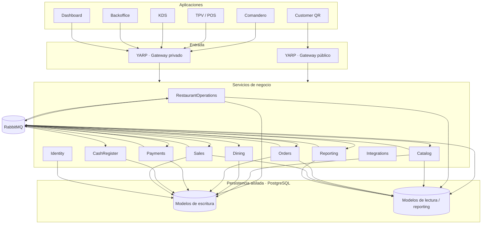
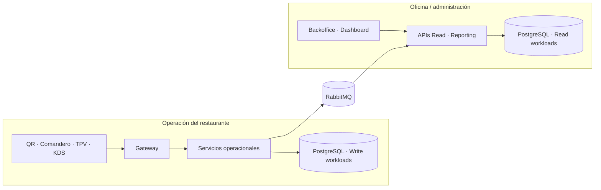
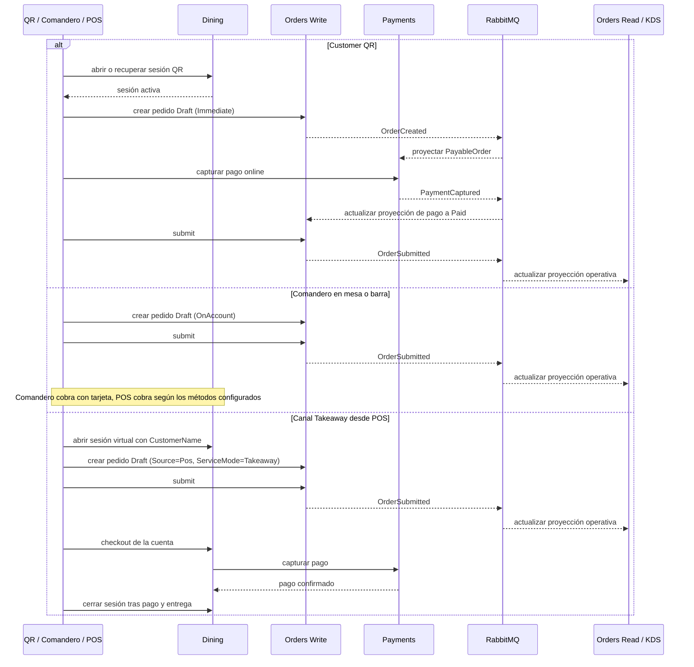
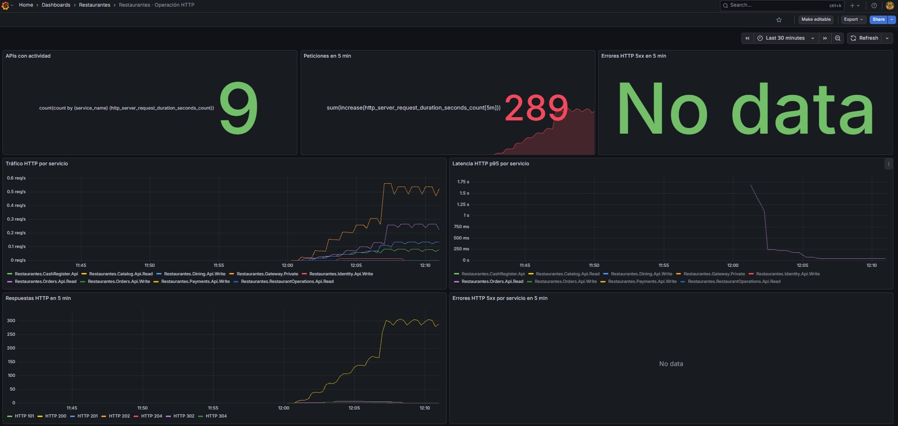
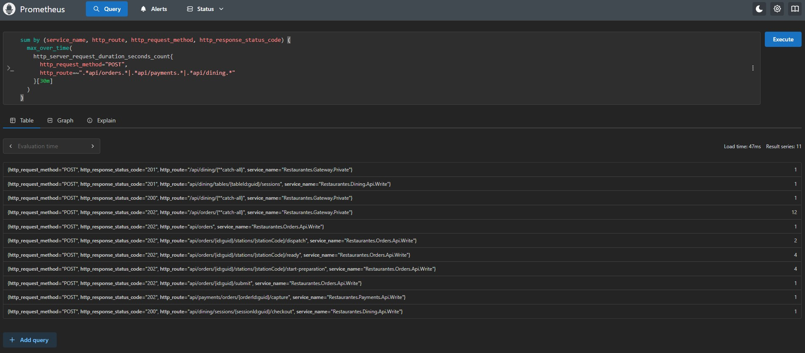

# 🍽️ Restaurantes

[](https://dotnet.microsoft.com/)
[](https://dotnet.microsoft.com/apps/aspnet/web-apps/blazor)
[](https://learn.microsoft.com/ef/core/)
[](https://microsoft.github.io/reverse-proxy/)

[](https://www.postgresql.org/)
[](https://www.rabbitmq.com/)
[](https://developer.hashicorp.com/vault)
[](https://docs.docker.com/compose/)

[](https://opentelemetry.io/)
[](https://opentelemetry.io/docs/collector/)
[](https://prometheus.io/)
[](https://grafana.com/)

**Restaurantes** es una plataforma distribuida para la operación y gestión de restaurantes, construida sobre **.NET 10**. Reúne servicios para catálogo, sala, pedidos, cocina, pagos, caja, ventas, identidad y reporting, con aplicaciones para clientes, personal y administración.

El repositorio presenta la arquitectura, sus objetivos y las áreas funcionales. Los detalles de cada servicio, flujo e infraestructura se encuentran en los [documentos de `docs`](docs/).

> [!IMPORTANT]
> El proyecto se encuentra en **desarrollo activo**. La arquitectura backend y varios flujos de negocio ya están implementados, mientras que algunas interfaces, integraciones externas, automatización de despliegue y cobertura de pruebas continúan evolucionando. El objetivo del repositorio es mostrar una arquitectura extensible y cercana a un escenario real, no presentar un producto comercial terminado.

## Objetivos de arquitectura

El objetivo principal es que **la operación del restaurante mantenga su capacidad de respuesta mientras la oficina consulta ventas, actividad e indicadores**. Por eso, algunos dominios separan lectura y escritura y pueden escalarse por separado.

Los principales objetivos son:

- **Aislar la carga transaccional de la carga de consulta.**
- **Escalar lectura y escritura de forma independiente.**
- **Evitar acceso directo entre bases de datos de distintos dominios.**
- **Reducir el impacto de fallos o despliegues de un servicio sobre el resto de la plataforma.**
- **Mantener contratos explícitos entre servicios mediante HTTP y eventos.**
- **Permitir despliegue cloud sin acoplar el dominio a un proveedor concreto.**
- **Mantener aplicaciones cliente independientes para cada perfil operativo.**

## Arquitectura general



CQRS se aplica donde aporta valor: **RestaurantOperations, Catalog, Orders y Sales** separan lectura y escritura; **Dining, Identity y CashRegister** mantienen una persistencia operacional. Los detalles de cada dominio están en sus documentos.

### YARP como punto único de entrada

YARP ofrece un origen de entrada para las interfaces, las APIs y las conexiones SignalR; los clientes no necesitan conocer los puertos internos.

| Gateway | Audiencia | Interfaces publicadas |
| --- | --- | --- |
| **Public Gateway** | Clientes externos | Customer QR en `/qr/{codigo}` |
| **Private Gateway** | Personal del local y oficina | Backoffice en `/backoffice/`, Comandero en `/commander/`, TPV en `/pos/`, KDS en `/kds/` y Dashboard en `/dashboard/` |

Rutas, CORS y despliegue se detallan en **[Gateways YARP](docs/Gateways.README.md)**; Customer QR en **[Dining](docs/Dining.README.md#interfaz-customer-qr)** y Dashboard en **[Reporting](docs/Reporting.README.md#gateways)**.

## Separación de lectura y escritura

En los dominios CQRS, los cambios se guardan primero en escritura; RabbitMQ distribuye los eventos que actualizan las proyecciones de lectura. Esto introduce **consistencia eventual** y permite escalar ambas cargas por separado.

### ¿Por qué bases separadas?

La separación no se utiliza únicamente como patrón arquitectónico. Responde al comportamiento esperado del sistema:

| Necesidad | Beneficio |
| --- | --- |
| Consultas de oficina | Reporting e historial no compiten por recursos con la operación. |
| Continuidad operacional | Pedidos, cocina, pagos y caja mantienen prioridad. |
| Escalado independiente | Lectura y escritura se dimensionan según su carga. |
| Modelos optimizados | Las proyecciones de lectura responden a las consultas de cada cliente. |
| Aislamiento y evolución | Fallos y cambios de lectura reducen su impacto en la operación. |
| Despliegue flexible | Cada base puede alojarse y dimensionarse por separado. |

En local, Compose levanta **dos instancias PostgreSQL**: una operativa y otra analítica. Los contextos mantienen esquemas y tablas `__EFMigrationsHistory` separados dentro de cada base.

| Base | Esquemas asignados |
| --- | --- |
| `restaurants_operational` | Identity, RestaurantOperations Write, Catalog Write, Dining, Orders Write, Payments, CashRegister y Sales Write. |
| `restaurants_analytics` | RestaurantOperations Read, Catalog Read, Orders Read, Sales Read y Reporting. |

Cada contexto usa el esquema indicado por su `Search Path`; esos nombres no representan bases independientes. Los servicios aplican migraciones al iniciar. En producción se conserva el aislamiento físico.

Compose utiliza volúmenes nuevos; no monta ni copia automáticamente los datos de volúmenes PostgreSQL anteriores.

## Estrategia de alojamiento cloud

La lógica de negocio no depende de un proveedor cloud concreto. La plataforma utiliza **.NET, PostgreSQL, RabbitMQ, HTTP, SignalR y YARP**; el despliegue cloud está previsto para una etapa posterior.

### Modelo de despliegue previsto



La infraestructura puede empezar con bases administradas y separar recursos según crezca la carga:

- **Bases operacionales de escritura:** priorizadas para baja latencia y continuidad del negocio.
- **Bases de lectura:** dimensionadas para consultas frecuentes de clientes y aplicaciones operativas.
- **Reporting:** aislado de la operación para consultas agregadas, históricas y de oficina.
- **Servicios con mayor demanda:** escalables de manera independiente sin tener que desplegar toda la plataforma como una unidad.

### Ejemplos de infraestructura compatible

| Componente | Azure | Alternativas |
| --- | --- | --- |
| APIs, gateways y workers .NET | Azure Container Apps, App Service o AKS | AWS ECS/EKS, Google Cloud Run/GKE, Kubernetes o contenedores propios |
| PostgreSQL | Azure Database for PostgreSQL | Amazon RDS for PostgreSQL, Google Cloud SQL, PostgreSQL administrado o self-hosted |
| RabbitMQ | RabbitMQ en infraestructura propia o proveedor administrado | Amazon MQ for RabbitMQ, CloudAMQP, Kubernetes o VM |
| PWA | Static Web Apps, Storage + CDN | S3/CloudFront, Cloudflare Pages, hosting estático |
| Aplicaciones ASP.NET Core | App Service, Container Apps o AKS | ECS, Cloud Run, Kubernetes o VM |
| SignalR | Self-hosted o Azure SignalR Service | SignalR self-hosted detrás de infraestructura compatible con WebSockets |
| Secretos y configuración | Key Vault | AWS Secrets Manager, GCP Secret Manager, Vault |

La elección del proveedor queda abierta para adaptar coste, capacidad y disponibilidad sin rediseñar los dominios.

## Comunicación entre servicios

La plataforma combina comunicación síncrona y asíncrona según lo requiera cada flujo.

### HTTP

HTTP atiende operaciones que requieren respuesta inmediata. En dominios CQRS, YARP puede enrutar según el verbo:

- `GET` → API de lectura.
- `POST`, `PUT`, `PATCH`, `DELETE` → API de escritura.

También existen llamadas HTTP entre servicios cuando el flujo necesita coordinación inmediata, como determinados procesos de cobro.

### RabbitMQ

RabbitMQ distribuye eventos entre dominios y alimenta proyecciones sin acceso directo entre bases de datos. La infraestructura incluye:

- publishers y consumers independientes;
- **Transactional Outbox** para persistir cambios y eventos de forma coordinada;
- **Inbox / idempotencia** en procesos que deben evitar reprocesamiento;
- exchanges y routing keys separados por dominio;
- **dead-letter exchanges y queues** para mensajes que no pueden procesarse correctamente.

## Tiempo real

**SignalR** propaga en tiempo real cambios de:

- sala y sesiones de mesa;
- estado de pedidos y KDS;
- reporting y dashboard.

Así, las interfaces se actualizan cuando cambian los servicios, sin depender de polling continuo.

## Seguridad

La autenticación usa **ASP.NET Core Identity y JWT**; los permisos se evalúan dentro del restaurante y en el servicio de dominio correspondiente. Proveedores, dominios y reglas de acceso se describen en [Identity](docs/Identity.README.md).

### Configuración JWT compartida

`Restaurantes.Security` centraliza emisor, audiencia y duración. La clave JWT compartida llega desde Vault; no se guarda en código, archivos versionados ni imágenes. La configuración local y productiva se detalla en [Identity](docs/Identity.README.md).

## Servicios

| Servicio | Responsabilidad | Persistencia |
| --- | --- | --- |
| **[RestaurantOperations](docs/RestaurantOperations.README.md)** | Gestión e información base de restaurantes. | Write + Read |
| **[Catalog](docs/Catalog.README.md)** | Categorías, productos, precios, disponibilidad y configuración de estaciones por restaurante. | Write + Read |
| **[Orders](docs/Orders.README.md)** | Pedidos, líneas, estados de preparación y coordinación del flujo de cocina/KDS. | Write + Read |
| **[Dining](docs/Dining.README.md)** | Zonas, mesas, sesiones, QR, comensales y cuenta de mesa. | Write |
| **[Payments](docs/Payments.README.md)** | Capturas, devoluciones y estado de cobro. | Write |
| **[Sales](docs/Sales.README.md)** | Consolidación de ventas originadas en la operación. | Write + Read |
| **[CashRegister](docs/CashRegister.README.md)** | Apertura/cierre de caja, jornada operativa y conciliación de efectivo. | Write |
| **[Identity](docs/Identity.README.md)** | Usuarios, roles, autenticación y acceso por restaurante. | Write |
| **[Reporting](docs/Reporting.README.md)** | Proyecciones agregadas para actividad y ventas. | Read |
| **[Integrations](docs/Integrations.README.md)** | Punto de extensión para proveedores y sistemas externos. | — |

Cada servicio es propietario de sus datos; colaboran mediante contratos HTTP o eventos.

## Aplicaciones

| Perfil | Aplicación | Propósito | Tecnología |
| --- | --- | --- | --- |
| Cliente | **Customer QR** | Pago online obligatorio antes de enviar el pedido a cocina y seguimiento desde el QR asociado a una mesa/sesión. | Blazor WebAssembly PWA |
| Camarero | **Comandero** | Pedidos de mesa, cobro con tarjeta y liberación de mesa. | Blazor WebAssembly PWA |
| Caja | **TPV / POS** | Pedidos de sala y barra, canal Takeaway, cuentas y caja. | Blazor WebAssembly PWA |
| Cocina | **KDS** | Preparación y despacho por estación. | ASP.NET Core Web |
| Administración | **Backoffice** | Restaurantes, catálogo, sala y usuarios. | Blazor WebAssembly PWA |
| Oficina | **Dashboard** | Ventas, actividad operativa y salud de endpoints. | ASP.NET Core Web |

Las interfaces y las integraciones externas siguen en evolución.

## Flujo simplificado de una operación



Customer QR cobra antes de enviar el pedido; el resto del flujo de pedidos se detalla en [Orders](docs/Orders.README.md), [Dining](docs/Dining.README.md) y [Payments](docs/Payments.README.md). La mensajería introduce consistencia eventual entre las proyecciones.

## Estructura del repositorio

```text
Restaurantes/
├── .config/
│   └── dotnet-tools.json
├── src/
│   ├── ApiGateways/
│   │   ├── Restaurantes.Gateway.Public
│   │   └── Restaurantes.Gateway.Private
│   │
│   ├── BuildingBlocks/
│   │   ├── Restaurantes.Messaging.RabbitMq
│   │   ├── Restaurantes.Security
│   │   └── Restaurantes.ServiceDefaults
│   │
│   ├── Clients/
│   │   ├── Restaurantes.Clients.Backoffice.Pwa
│   │   ├── Restaurantes.Clients.Commander.Pwa
│   │   ├── Restaurantes.Clients.CustomerQr.Pwa
│   │   ├── Restaurantes.Clients.Dashboard.Web
│   │   ├── Restaurantes.Clients.Kds.Web
│   │   ├── Restaurantes.Clients.Pos.Pwa
│   │   └── Restaurantes.Clients.Shared.Operations
│   │
│   └── Services/
│       ├── CashRegister
│       ├── Catalog
│       ├── Dining
│       ├── Identity
│       ├── Integrations
│       ├── Orders
│       ├── Payments
│       ├── Reporting
│       ├── RestaurantOperations
│       └── Sales
│
├── tools/
│   ├── pgadmin/
│   └── postgres/init/
├── docker-compose.yml
├── Restaurantes.slnLaunch
└── Restaurantes.slnx
```

Los servicios con mayor complejidad se subdividen en proyectos de **Domain, Application,
Infrastructure y Contracts**, además de sus ejecutables. Catalog, Orders y
RestaurantOperations reúnen sus rutas de lectura y escritura en una API por servicio.
Sales y Reporting conservan servicios independientes. Cada uno aloja consumidores y
publicadores en `Infrastructure/Workers` y los ejecuta desde su propia API.

Las API ejecutan también sus workers. Los perfiles de Visual Studio levantan los servicios
necesarios para el cliente elegido.

## Entorno local

### Requisitos

- .NET 10 SDK
- Docker / Docker Compose
- Visual Studio 2026 o un entorno compatible con .NET 10

### Infraestructura

Compose levanta PostgreSQL, RabbitMQ, pgAdmin, Vault y la pila local de observabilidad. SonarQube Community Build está en el perfil opcional `quality`. Los scripts de `tools/postgres/init` crean las bases lógicas.

Configura `tools/vault/.env` desde `.env.example` con valores locales y pásalo explícitamente a Compose. El archivo está excluido de Git.

```bash
docker compose --env-file tools/vault/.env up -d
```

Los servicios aplican sus migraciones de Entity Framework Core al iniciar.

### Observabilidad local

OpenTelemetry envía métricas HTTP y de runtime por **Collector → Prometheus → Grafana**. Prometheus usa `http://localhost:9090`; Grafana, `http://localhost:3000` (credenciales en `tools/vault/.env`). Los dashboards de **Restaurantes** cubren gateways, APIs, dependencias, pedidos y runtime.

Dashboards y métricas: [Observabilidad de gateways y APIs](docs/Gateways.README.md#observabilidad-de-gateways-y-apis).

#### Evidencias visuales

Actividad HTTP y latencia p95 durante una operación:



Métricas del flujo de mesa, pedido, KDS, pago y cierre:



### Calidad y seguridad local

SonarQube Community Build se inicia bajo el perfil opcional `quality`:

```powershell
docker compose --env-file tools/vault/.env --profile quality up -d sonarqube
```

Proporciona el token de análisis solo en la sesión actual de PowerShell:

```powershell
$env:SONAR_TOKEN = "<token-de-analisis>"
.\tools\sonar\Invoke-SonarQubeLocalAnalysis.ps1
```

El análisis ejecuta las validaciones de calidad y espera el **Quality Gate**:

Para ejecutar solo las pruebas de KDS:

```powershell
.\tools\sonar\Invoke-KdsCoverage.ps1
```

Para detener únicamente esta infraestructura:

```powershell
docker compose --env-file tools/vault/.env --profile quality stop sonarqube sonarqube-db
```


### Integración continua y calidad local

`develop` integra los cambios; `master` es la rama estable. El [workflow de CI](.github/workflows/ci.yml) compila, ejecuta pruebas y publica cobertura. SonarQube local valida el Quality Gate antes de promover a `master`.

### Scripts PostgreSQL

- `tools/postgres/seed/01-development-catalog.sql`
- `tools/postgres/reset-operational-data.sql`

### Restaurar herramientas y dependencias

```bash
dotnet tool restore
dotnet restore
dotnet build Restaurantes.slnx
```

Los perfiles `.slnLaunch` levantan los procesos de cada escenario, con o sin navegador. Abre las interfaces por las rutas de [YARP](#yarp-como-punto-único-de-entrada).

## Tooling

El manifiesto local de herramientas .NET incluye:

- `dotnet-ef`
- `csharpier`
- `dotnet-sonarscanner`

Para aplicar formato al código:

```bash
dotnet csharpier format .
```

---

Este repositorio forma parte de mi portfolio técnico sobre arquitectura distribuida y aplicaciones .NET para un dominio operativo real.
